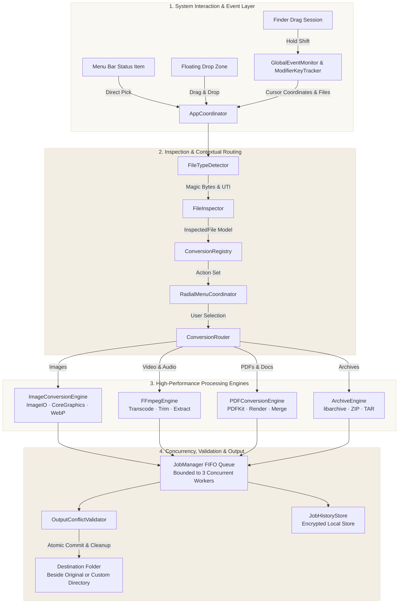
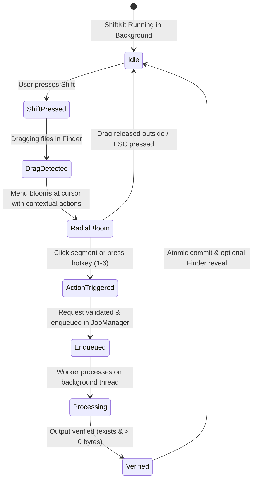

# ShiftKit

<p align="center">
  <strong>Every file. One gesture.</strong><br>
  A local-first, privacy-respecting radial file action utility for macOS.
</p>

<p align="center">
  
</p>

<p align="center">
  
  
  
  
  
  
</p>

<p align="center">
  <a href="#system-architecture">Architecture</a> •
  <a href="#interaction-flow">Interaction Flow</a> •
  <a href="#core-capabilities">Capabilities</a> •
  <a href="#quick-start">Quick Start</a> •
  <a href="#testing--verification">Testing</a> •
  <a href="#dmg-packaging">Packaging</a> •
  <a href="#privacy--security">Privacy</a> •
  <a href="#documentation">Docs</a>
</p>

---

## Overview

**ShiftKit** eliminates file conversion clutter on macOS. Instead of opening heavy converter apps or uploading sensitive assets to cloud websites, ShiftKit activates a circular radial action menu right under your cursor whenever you drag files with the `Shift` key held down.

Conversions, compressions, crops, trims, and merges execute **100% on your Mac** using native frameworks (`ImageIO`, `CoreGraphics`, `PDFKit`, `AVFoundation`) and optimized engines.

---

## System Architecture

ShiftKit is structured as a decoupled, reactive pipeline separating system event observation, file inspection, routing, hardware-accelerated processing, and safe atomic storage.



---

## Interaction Flow

ShiftKit tracks gestures without intercepting private Finder data until you commit an action.



---

## Core Capabilities

| Category | Formats | Supported Operations | Engine |
| :--- | :--- | :--- | :--- |
| **Images** | `PNG`, `JPEG`, `WebP`, `HEIC`, `TIFF`, `BMP`, `GIF`, `AVIF` | Format conversion, lossy/lossless compression, EXIF stripping, visual aspect-ratio crop editor | `ImageIO`, `CoreGraphics`, `libwebp` |
| **Video** | `MP4`, `MOV`, `MKV`, `WebM` | Hardware transcoding (H.264 / HEVC / ProRes), downscaling (1080p, 720p), stream trimming, audio removal | `FFmpegEngine` (Apple Silicon NEON accelerated) |
| **Audio** | `MP3`, `AAC`, `WAV`, `FLAC`, `M4A`, `OGG` | Bitrate conversion (64k–320k), normalization, trim, sample rate scaling, audio extraction from video | `FFmpegEngine` |
| **Documents** | `PDF`, `RTF`, `TXT` | Multi-file PDF merge, page splitting, reordering, rotation, watermark annotation, rasterize pages to PNG/JPEG | `PDFKit` |
| **Archives** | `ZIP`, `TAR.GZ` | Compression, multi-file bundling, folder archiving | `libarchive` |

---

## Quick Start

### Requirements
- macOS 14.0 (Sonoma) or macOS 15.0+ (Sequoia)
- Xcode 15 or 16 (`xcode-select --install`)
- [XcodeGen](https://github.com/yonaskolb/XcodeGen) (`brew install xcodegen`)
- Optional for video/audio features: [FFmpeg](https://ffmpeg.org) (`brew install ffmpeg`)

### Build from Source
```bash
# 1. Clone the repository
git clone https://github.com/MdKasif0/ShiftKit.git
cd ShiftKit

# 2. Generate the Xcode project from project.yml
xcodegen generate

# 3. Build the Release Universal binary
xcodebuild build \
  -project ShiftKit.xcodeproj \
  -scheme ShiftKit \
  -configuration Release \
  -destination "platform=macOS"
```

The built app bundle is located at [`build/Release/ShiftKit.app`](build/Release/ShiftKit.app).

---

## Testing & Verification

ShiftKit maintains an automated test suite with **150 test cases** covering every engine, error scenario, and concurrency boundary:

```bash
# Run complete test suite
xcodebuild test \
  -project ShiftKit.xcodeproj \
  -scheme ShiftKit \
  -destination "platform=macOS"
```

### Verified Test Matrix
- **Image Operations**: PNG/JPEG/WebP/TIFF conversion, alpha preservation, crop bounds clamping, large image memory safety.
- **Audio & Video Processing**: Lossless trimming, audio extraction, corrupt file rejection, codec availability checks.
- **PDF & Document Utilities**: Multi-image stitching, page splitting, PDF merging, metadata modification.
- **Concurrency & Concurrency Limits**: Thread-safe FIFO queue bounded to max 3 concurrent tasks to prevent memory pressure.
- **Conflict Handling**: Automatic suffixing (`_1`, `_2`), destination collision handling, zero-byte output rejection.

---

## DMG Packaging

Create a production-ready Apple Disk Image (UDZO) with custom staging and metadata:

```bash
chmod +x scripts/package_dmg.sh
./scripts/package_dmg.sh
```

- **Output**: `dist/ShiftKit-1.0.0.dmg`
- **File Size**: ~4.6 MB (Compressed)
- **Features**: Includes embedded `ShiftKit.app`, `/Applications` symlink, installation guide, and auto-generated `release_metadata.json` with SHA-256 verification.

---

## Privacy & Security

- **0 Network Requests**: ShiftKit contains **no network calls** (`URLSession`, `NWConnection`, analytics SDKs, or cloud endpoints). All processing is strictly offline.
- **Hardened Runtime**: Built with `ENABLE_HARDENED_RUNTIME = YES` and sandboxed entitlements (`com.apple.security.files.user-selected.read-write`).
- **Atomic File Commit**: Working files are generated in isolated temporary folders and only committed to disk upon passing validation checks.
- **Clean Workspace**: Failed or cancelled jobs automatically purge temporary scratch files immediately.

---

## Documentation

- [Build & Packaging Guide](docs/BUILD_AND_PACKAGING.md)
- [Code Signing & Notarization Guide](docs/CODE_SIGNING_AND_NOTARIZATION.md)
- [User Installation & Permissions](docs/USER_INSTALLATION_GUIDE.md)
- [Release Checklist](docs/RELEASE_CHECKLIST.md)
- [Troubleshooting & FAQ](docs/TROUBLESHOOTING.md)
- [Third-Party Licenses](THIRD_PARTY_LICENSES.md)

---

## License

ShiftKit is open source software licensed under the [MIT License](LICENSE). Third-party dependencies and notices are documented in [THIRD_PARTY_LICENSES.md](THIRD_PARTY_LICENSES.md).
